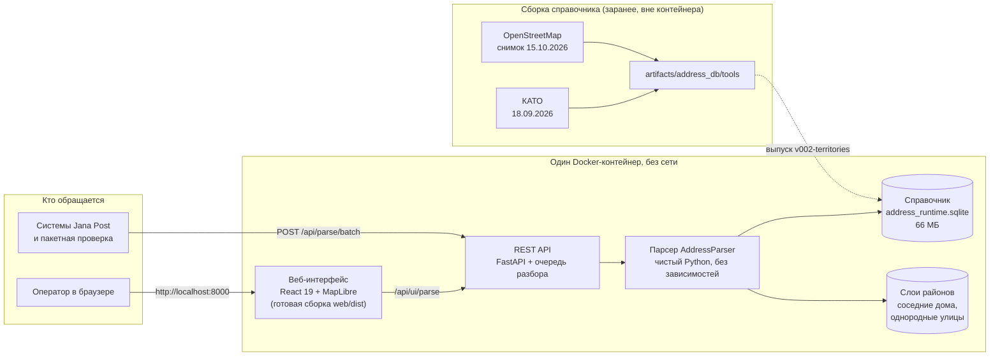
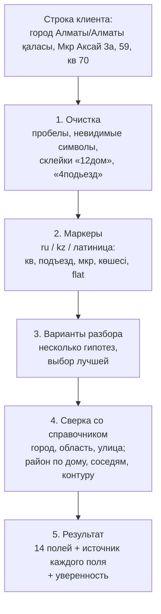

# Jana Address — разбор адресов доставки для Jana Post

> **Сервис, который превращает адрес «как написал клиент» в 14 структурированных полей.**
> Строку вида «66квартал 12дом 69квартира» или «Туран 55/6 магазин береке 4подьезд 9этаж» он раскладывает на область, город, район, жилой массив, тип и название улицы, дом, квартиру, подъезд, этаж, ориентир и уверенность разбора. Недостающие город, область и район восстанавливаются по собственному справочнику адресов Казахстана, собранному из OpenStreetMap и КАТО.
> Всё работает в **одном Docker-контейнере без интернета**.

Кейс 01 «Jana Address», хакатон Jana Post × Terricon Valley 2026. Команда **Commit and Pray**.

<p align="center">
  
  
  
  
  
  
  
  
  
</p>

---

## 📌 Содержание
1. [Проблема и ценность решения](#-проблема-и-ценность-решения)
2. [Быстрый запуск](#-быстрый-запуск)
3. [Архитектура](#-архитектура)
4. [Как устроен разбор](#-как-устроен-разбор)
5. [Справочник адресов](#-справочник-адресов)
6. [REST API](#-rest-api)
7. [Веб-интерфейс](#-веб-интерфейс)
8. [Качество и скорость](#-качество-и-скорость)
9. [Сценарии для демонстрации](#-сценарии-для-демонстрации)
10. [Структура репозитория](#-структура-репозитория)
11. [Разработка и тесты](#-разработка-и-тесты)
12. [Лицензии и данные](#-лицензии-и-данные)

---

## 🎯 Проблема и ценность решения

| Сейчас | С Jana Address |
|---|---|
| Адрес приходит одной строкой в произвольной форме, на русском, казахском, латиницей, со склейками «26кв31» | Строка раскладывается на 14 полей в формате, который понимают системы Jana Post |
| Нет аналитики по городам и районам: в строке часто нет ни города, ни района | Город, область и район восстанавливаются по справочнику, даже если их нет в строке |
| Курьер звонит клиенту уточнить квартиру, подъезд и этаж | Сразу видно, каких деталей не хватает, и это можно запросить у клиента при оформлении |
| Зону доставки приходится определять вручную | Район и микрорайон определяются по номеру дома, соседним домам и контурам территорий |
| Внешние геосервисы требуют интернета и передачи адресов клиентов наружу | Всё работает локально, в одном контейнере, без сети: данные клиентов никуда не уходят |

---

## 🚀 Быстрый запуск

Нужен Docker (на Windows — Docker Desktop в режиме Linux-контейнеров) и свободный порт 8000.

**Без интернета, из готового образа.** Архив `jana-address.tar` (71 МБ, Linux/amd64) передаётся вместе с решением. В git его нет из-за размера. Контрольная сумма лежит в [`jana-address.tar.sha256`](jana-address.tar.sha256).

```bash
docker load -i jana-address.tar    # один раз
docker compose up -d               # запуск: сборка и сеть не нужны
```

Без репозитория то же самое делает одна команда: `docker run -d -p 8000:8000 --name jana-address jana-address:1.0.0`.

**Из исходников.** Это подготовительный шаг, нужен интернет: базовый образ Python и пакеты из `requirements.txt` с версиями из `constraints.txt`.

```bash
git lfs install
git clone https://github.com/KItsunexdd/Commit-and-Pray-team.git
cd Commit-and-Pray-team
docker compose up -d --build
```

Через 2 секунды после запуска:
- веб-интерфейс — http://localhost:8000;
- проверка готовности — http://localhost:8000/api/health;
- документация API (работает без интернета, запрос можно отправить прямо со страницы) — http://localhost:8000/api/docs.

Журнал: `docker compose logs -f`. Остановка: `docker compose down`. Порт задаётся переменной `PORT`. В Bash: `PORT=9000 docker compose up -d`. В PowerShell: `$env:PORT='9000'; docker compose up -d`.

---

## 🏗 Архитектура

Один процесс FastAPI отдаёт и REST API, и собранный веб-интерфейс. Парсер написан только на стандартной библиотеке Python и читает справочник SQLite в режиме «только чтение».



**Почему так:**
- **Один контейнер** — меньше шансов, что что-то не соберётся или не запустится без сети.
- **Парсер без внешних зависимостей** — его можно встроить в любую Python-систему Jana Post отдельно от API.
- **Общая очередь разбора** — разбор нагружает процессор, поэтому параллельные запросы встают в очередь к одному прогретому потоку и не мешают друг другу.
- **Защита от тяжёлых запросов** — лимит тела запроса (64 МБ, в том числе для потокового multipart), лимит длины одной строки и корректная обработка «битых» символов Unicode.

---

## 🔍 Как устроен разбор



1. **Очистка.** Нормализуются пробелы, невидимые символы и слитные формы: «12дом», «4подьезд», «66квартал», «Жандосова58кв12».
2. **Маркеры.** Слова-подсказки на русском, казахском и латинице связывают числа с полями. Поддерживаются сокращения и опечатки маркеров: «кв-ра», «подъез», «етаж», «шағын ауданы», «flat», «entrance».
3. **Варианты.** Парсер строит несколько вариантов разбора и выбирает лучший. Например, `26кв31` → дом 26, квартира 31.
4. **Справочник.** Город и улица сверяются с базой. Район восстанавливается, даже если его нет в строке: по точному дому, по соседним домам или по контуру микрорайона. Если в строке нет города, а улица с этим домом есть ровно в одном населённом пункте, город подставляется. Справочник также помогает при неточной записи: приклеенный город («Улица МатасыАстана»), падеж («Сакен Сейфуллина»), опечатка в одну букву.
5. **Результат.** Улица и номера отдаются ровно так, как написаны в строке: опечатки не исправляются. Для каждого поля известно, откуда оно взято: из строки или из справочника.

Если источники района противоречат друг другу, район остаётся `null`: ложное значение хуже пустого.

---

## 🗺 Справочник адресов

SQLite на 66 МБ, собран нашими скриптами ([`artifacts/address_db/tools`](artifacts/address_db/tools)) из **OpenStreetMap** (снимок от 15.10.2026) и **КАТО** (18.09.2026).

| Что | Сколько |
|---|---:|
| Регионы (области и города республиканского значения) | 20 |
| Города | 90 |
| Районы | 195 |
| Улицы | 58 803 |
| Микрорайоны и жилые массивы | 11 607 |
| Дома | 1 099 024 |
| Территории (микрорайоны, ЖК) с районом по контуру | 1 122 |

Названия приведены к реформе 2022 года: Абайская, Жетысуская, Улытауская области, Конаев. Известное ограничение: в OpenStreetMap нет границ районов Караганды, поэтому там район берётся только из строки. Схема базы — [`artifacts/address_db/SCHEMA.md`](artifacts/address_db/SCHEMA.md).

---

## 🔌 REST API

| Метод | Путь | Что делает |
|:---:|---|---|
| `POST` | `/api/parse/batch` | Пакетный разбор. Ответ строго в формате `Samples/sample_output.json` |
| `POST` | `/api/parse` | Разбор одной строки |
| `POST` | `/api/ui/parse` | Разбор с пояснениями: позиции полей в строке и источник каждого значения |
| `GET` | `/api/health` | Готовность сервиса |
| `GET` | `/api/info` | Версия, сведения о справочнике, метрики |
| `GET` | `/api/docs` | Swagger UI из файлов внутри образа, работает без интернета |
| `GET` | `/api/openapi.json` | Схема OpenAPI 3.1 |

Вход — массив `[{"id": "...", "raw_address": "..."}]`, обёртка `{"records": [...]}` или JSON-файл в поле `file` формы multipart. На каждую запись возвращается ровно 14 полей. Порядок записей сохраняется, повторяющиеся `id` возвращаются как есть, неизвестное значение — `null`.

```bash
curl -X POST http://localhost:8000/api/parse/batch -H "Content-Type: application/json" --data-binary @Samples/sample_input.json
```

В PowerShell — та же строка с `curl.exe`. Файл можно отправить и формой: `curl -F file=@Samples/sample_input.json http://localhost:8000/api/parse/batch`.

```json
{
  "id": "rec_00417",
  "raw_address": "город Алматы/Алматы қаласы, Мкр Аксай 3а, 59, кв 70",
  "province": "Алматы", "city": "Алматы", "district": "Ауэзовский",
  "living_area": null, "street_type": "микрорайон", "street_name": "Аксай 3а",
  "house": "59", "apartment": "70", "entrance": null, "floor": null, "landmark": null,
  "confidence": 0.82
}
```

Полный контракт, лимиты и коды ошибок — [`docs/api.md`](docs/api.md).

---

## 🖥 Веб-интерфейс

| Экран | Что можно сделать |
|---|---|
| **Карта и поиск** | Ввести адрес и сразу увидеть разбор: поля подсвечены прямо в строке, у каждого значения указан источник. Карта подлетает к найденной области |
| **Проверка файла** | Загрузить JSON, отфильтровать сомнительные записи, поправить значения вручную, выгрузить результат в JSON (формат проверки), Excel или CSV |
| **Аналитика** | Распределение адресов файла по регионам и полноте деталей |
| **Как это работает** | Источники справочника, его объём и показатели качества |
| **Демо** | Автоматический показ разбора на подготовленных адресах |

Светлая тема в цветах Jana Post и тёмная тема, режим без карты для слабых компьютеров, адаптация под телефон. Подробнее — [`web/README.md`](web/README.md).

---

## 📊 Качество и скорость

Скорость замерена в контейнере, запущенном с `--network none`:

| Показатель | Результат | Требование |
|---|---|---|
| Запуск контейнера до готовности | около 2 с | не дольше 3 минут |
| 1000 адресов через `/api/parse/batch` | 0,5–0,7 с | не дольше 5 минут |
| Размер образа | 330 МБ (архив — 71 МБ) | — |

Качество разбора:

| Набор | Результат |
|---|---|
| 123 адреса на реальных улицах, написанные вручную отдельно от разработки (версия v5) | **93,6%** (95% интервал 87,6–97,9%) |
| 504 записи «как пишут люди» на реальных улицах Астаны, Алматы и Шымкента: приклеенный город, город в конце улицы, падеж, опечатка в районе, запись без города (v11 → v12) | **71,4% → 99,6%** записей без ошибок |
| Массовая проверка: 20 000 реальных домов из справочника, 600 населённых пунктов, 34 тысячи однозначных записей | **99,55%**, ноль падений |
| Закрытый синтетический test (300 строк), открыт один раз по заранее зафиксированному протоколу | **100%**, 1188 из 1188 ячеек |

**Как читать эти цифры.** Самая честная оценка — первая строка: адреса составлены независимо, и правила под них не подгонялись. Синтетические наборы построены по известным шаблонам, поэтому 99–100% на них не означают «99–100% на любых адресах». Главный риск по метрике — форма названий трёх новых областей: «Абайская область» или официальная форма КАТО «область Абай». Подробности — в [`docs/overview.md`](docs/overview.md).

---

## 🎬 Сценарии для демонстрации

| # | Что ввести | Что показать |
|:---:|---|---|
| 1 | `город Алматы/Алматы қаласы, Мкр Аксай 3а, 59, кв 70` | Пример организаторов: район «Ауэзовский» восстановлен по справочнику, хотя в строке его нет |
| 2 | `Туран 55/6 магазин береке 4подьезд 9этаж` | Города нет — справочник находит Астану и район Нұра по улице и дому; ориентир, подъезд и этаж разобраны из склеек |
| 3 | `66квартал 12дом 69квартира` | Слитная запись без пробелов |
| 4 | `Улица Шаймерден КосшыгулулыАстана, 20 Сырыарка` | Город приклеен к улице, район с опечаткой: город отрезан и подтверждён справочником, район сохранён как в строке |
| 5 | `Тараз қаласы, Якутская көшесі 381 үй, пәтер 146` | Запись на казахском |
| 6 | Файл `Samples/sample_input_2.json` на экране «Проверка файла» | Фильтр сомнительных записей, ручная правка, выгрузка в Excel |
| 7 | `docker run --network none …` и `/api/docs` | Сервис и документация работают без интернета |

---

## 📁 Структура репозитория

```
Commit-and-Pray-team/
├── Dockerfile, docker-compose.yml     # Сборка и запуск одного контейнера
├── requirements.txt, constraints.txt  # Зависимости сервиса с закреплёнными версиями
├── jana-address.tar.sha256            # Контрольная сумма архива образа
├── app/                               # FastAPI-сервис
│   ├── main.py                        # Маршруты, очередь разбора, лимиты, Swagger UI без сети
│   ├── service.py                     # Чтение входа, пакетный разбор, пояснения для интерфейса
│   ├── openapi.py                     # Схемы OpenAPI 3.1
│   ├── static/swagger/                # Локальные файлы Swagger UI
│   └── test_api.py                    # Тесты API
├── AddressParser/                     # Парсер (только стандартная библиотека Python)
│   ├── parser.py                      # Очистка, маркеры, варианты разбора, выбор лучшего
│   ├── reference.py                   # Сверка со справочником
│   ├── territories.py, neighbours.py, uniform.py  # Восстановление района
│   ├── evaluate.py, benchmark.py      # Метрика и замеры скорости
│   └── test_*.py                      # Тесты парсера
├── artifacts/
│   ├── address_db/                    # Справочник SQLite (Git LFS) и скрипты сборки из OSM и КАТО
│   └── baseline/                      # Слои районов: соседние дома и однородные улицы (Git LFS)
├── web/                               # Веб-интерфейс: React, TypeScript, Vite, Tailwind, MapLibre
│   ├── src/                           # Карта, поиск, проверка файла, аналитика, экспорт, темы
│   └── dist/                          # Готовая сборка, отдаётся сервисом
├── data/geo/                          # Границы регионов и города для карты
├── scripts/                           # Запуск тестов, сборка геоданных, сбор источников
├── datasets/evaluation/gold/T3.1_A1/  # Открытая часть эталона (dev, 300 строк)
├── Samples/                           # Пример входа и выхода организаторов
└── docs/                              # Контракт API и описание проекта простыми словами
```

---

## 🧪 Разработка и тесты

```bash
pip install -r requirements-dev.txt
python scripts/run_tests.py        # 113 тестов API и парсера
python -m app                      # сервис на http://localhost:8000
cd web && npm ci && npm test && npm run build
```

Регрессия на 6000 строк train запускается, если положить `datasets/train/train.jsonl`. Файл слишком большой для git и передаётся отдельно. Без него `run_tests.py` пропускает этот тест и сообщает об этом.

---

## 📜 Лицензии и данные

- Картографические и адресные данные: © участники OpenStreetMap, лицензия ODbL 1.0.
- КАТО — открытые данные Бюро национальной статистики Республики Казахстан.
- MapLibre GL JS — BSD 3-Clause. Swagger UI — Apache 2.0. Шрифты Inter, JetBrains Mono, Noto Sans Mono — SIL Open Font License.
